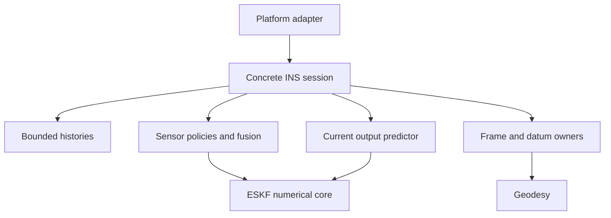
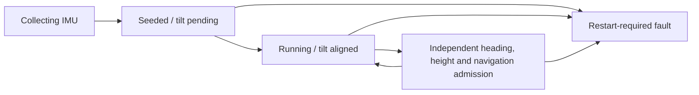

# Portable Navigation Runtime Architecture

## Scope and requirements

[SW-NAV](../requirements/software/navigation-runtime.md) defines a concrete,
caller-driven INS session. [C-LAYER-BOUNDARY](../requirements/common/layer-boundaries.md)
and the [C++ subset](../requirements/common/cpp-subset.md) constrain dependencies
and implementation. Implementation status belongs
to [A-01](../../roadmap.md#a-01--portable-navigation-runtime).

The binary64 INS session retains PX4 250 Hz timing, core equations, numerical
choices and separate AHRS APIs. Startup now follows the staged contract below.
New rate modes and stationary updates remain separately scoped. Corrected output
uses the existing predictor; independent continuous odometry is outside the
[navigation-output target](navigation-output.md).

The [staged INS target](../profiles/staged-ins.md) allocates that startup and
degradation work to [R-INS-STARTUP](../requirements/runtime/ins-startup.md) and
[R-INS-CAPABILITIES](../requirements/runtime/ins-capabilities.md). The target keeps
one full INS and existing phase ownership. It separates output admission from
state dimension, geographic admission and source lifecycle. An attitude-only
output path uses current quaternion/history without requiring position geometry;
frame attachment coordinates the affected owners when geographic prerequisites
become available. Staged seed, independent output admission and first attachment are implemented;
numerical continuity and real-source recovery are integrated. Formal, broader
physical and deployment-resource qualification remain explicit A-03 work.

[R-INS-CONTINUITY](../requirements/runtime/ins-continuity.md) allocates the staged
source-loss policy to the session: real-aiding clocks and bias permissions precede
real corrections; constrained numerical covariance updates precede output
feedback. These operations retain full fixed-size P and separate intervention
provenance. Their pure covariance algebra belongs below session policy; platform
status/reset delivery remains in the adapter. The numerical gain constraints do not modify the shared real-observation models.
`fusion/covariance_guard.hpp` owns the covariance-only Joseph algebra;
`session/ins_continuity.hpp` owns bounded attempt/provenance state. Session
coordination supplies actual source, observation-frame and history prerequisites.
No second state estimate or persistent shadow covariance is introduced.

## Responsibilities and interfaces

| Owner | State and responsibility | External boundary |
|---|---|---|
| INS session | Main state/P, bootstrap, component coordination, fault/reset state | Receives explicit inputs/time/configuration; returns phase results and coherent views |
| Histories | IMU intervals, observations, context, generations and watermarks | Fixed storage; no device or clock acquisition |
| Sensor owners | Qualification, sampling, source lifecycle and recovery | Consume explicit context and current prior; no platform flags or message publication |
| Frame/datum owners | Working/reference geometry, datum and prepared origin event | Geodesy supplies pure transformations |
| Output predictor | Current nominal state, retained history and delayed feedback | Separate epoch; no current covariance or sensor-selection authority |
| Adapter | Drivers/messages, time conversion, external context/model lookup, scheduling and publication | One writer invokes bounded session phases |

Runtime headers are grouped by responsibility: `history/`, `frames/`, `fusion/`,
`sensors/` and `session/`. Sensor families may have cohesive subdirectories.
Directory grouping does not create inheritance, policy dispatch or one-class-per-
file obligations. Histories depend on sample values/storage, not prediction
policy. Session composes lower components; lower components do not include it.

### Mixed-precision target

[R-NAV-PRECISION](../requirements/runtime/navigation-precision.md) extends the
session's numerical applicability without changing the Cartesian equations or
phase ownership. InsSession selects local binary32 or binary64 through its backend;
LocalNed and datum geometry remain binary64. Explicit checked boundaries separate
them. Host software tests do not establish a binary32 deployment profile.
The [precision profile](../profiles/navigation-precision.md)
owns the boundary inventory, candidate builds and unresolved acceptance limits.

| Owner | Precision responsibility |
|---|---|
| Geodesy and frame/datum geometry | Retain binary64 coordinates, Earth-scale subtraction and geographic transforms. |
| Core, sensor policies and histories | Use the selected local scalar consistently for local algebra; preserve geographic fields and integer time/source domains. |
| Session/frame coordination | Prepare and validate conversions, preserve transaction boundaries, and coordinate initialization, rebases, resets and feedback without a second main state/P. |
| Adapter and qualification | Retain message types; identify effective precision/epochs and qualify declared numerical/resource budgets on the selected target. |

PX4 v1.16.2, commit `54f0455ffcd755534539a7cf33a09a20bf71d29d`, uses float
[state](https://github.com/PX4/PX4-Autopilot/blob/54f0455ffcd755534539a7cf33a09a20bf71d29d/src/modules/ekf2/EKF/python/ekf_derivation/generated/state.h),
[covariance](https://github.com/PX4/PX4-Autopilot/blob/54f0455ffcd755534539a7cf33a09a20bf71d29d/src/modules/ekf2/EKF/ekf.h)
and local [predictor algebra](https://github.com/PX4/PX4-Autopilot/blob/54f0455ffcd755534539a7cf33a09a20bf71d29d/src/modules/ekf2/EKF/output_predictor/output_predictor.h).
Its [LatLonAlt](https://github.com/PX4/PX4-Autopilot/blob/54f0455ffcd755534539a7cf33a09a20bf71d29d/src/lib/lat_lon_alt/lat_lon_alt.hpp)
stores double latitude/longitude and float altitude; its
[ECEF conversion](https://github.com/PX4/PX4-Autopilot/blob/54f0455ffcd755534539a7cf33a09a20bf71d29d/src/lib/lat_lon_alt/lat_lon_alt.cpp)
uses double geometry. This project retains binary64 geographic height/datum
arithmetic and a selectable local scalar with binary64 default. This alignment
of responsibilities does not copy PX4's navigation formulation, tolerances or
deployment qualification.

The [precision cases](../verification/tests/runtime/navigation-precision.md) require the
whole session and its callers. Existing binary32 core evidence remains limited
to its original scope; scoped native session tests do not establish numerical
or target deployment qualification.

### Navigation output target

The [output design](navigation-output.md) retains this existing ownership split.
R-NAV-OUTPUT makes corrected local/global products, reference points, independent
validity and covariance epochs explicit. PX4-OUT binds existing wire messages;
controllers and Commander remain external. No second tracker, covariance, source
policy or new architectural layer is required. The four planned output families
qualify actual callers and consumers before this target is claimed implemented.

## Execution and state

### Sensor-input and IMU source-change allocation

[R-SENSOR-INPUT](../requirements/runtime/sensor-input.md) owns the common input
contract. [R-IMU-SOURCE](../requirements/runtime/imu/source-change.md) replaces
identity-only session restart. Native continuation tests cover the current path;
historical mismatch-rejection proofs require migration. It does not add a sensor voter, general sensor registry or new motion model.

| Owner | Target responsibility |
|---|---|
| Driver/adapter | Qualified clock mapping, unit/body-axis conversion, real source/calibration identity and physical reference point. No duplicate source policy. |
| Deployment profile | Rate-specific timing/storage, noise representation, filter/count settings and physical/resource qualification. |
| Core | [E-BIAS-RESET](../requirements/core/bias-reset.md): selected bias zeroing and covariance decorrelation/prior, without clocks or source detection. |
| Runtime session | Detect each admitted source event once, reset the affected bias/learning state before new input, retain queued history and continue ordinary phase order. |
| Histories/output | Preserve chronological old/new inputs, current/delayed epochs and existing output bias-feedback boundary; no implicit rewind or history clear. |

Aiding sources retain their existing generation/requalification owners. The IMU
change path requires its own bias/P and caller-sequence evidence, not removal of
a guard. Reuse one numerical reset and direct session orchestration; the
allocation does not require a new class or wrapper per responsibility.

### Optional barometric height allocation

The [barometric target profile](../profiles/barometric-height.md) extends existing
height aiding. Conversion/admission, shared observation preparation, derived
warmup/receipt tracking and optional geographic-session fusion are implemented.
Relative startup and first geographic attachment compose through staged INS;
their remaining acceptance partitions belong to A-03.
These changes do not alter core state,
prediction, Joseph correction or quaternion conventions. Requirements are
[R-BAROMETRIC-ALTITUDE](../requirements/runtime/barometric-altitude.md) and
[R-HEIGHT-AIDING](../requirements/runtime/height-aiding.md).

| Boundary | Responsibility |
|---|---|
| Driver/adapter | Calibrated Pa or existing model altitude, selected source/calibration identity, effective/receipt times and sensor-domain premises. PX4 retains `baro_alt_meter`; it does not reconvert or fuse pressure from the same sample separately. |
| Runtime sensor conversion | Bounded pure pressure/model-altitude admission and failure-preserved output under `sensors/height/`; no clocks, bias history, QNH watcher or platform access. |
| Runtime observation preparation | Common height preparation under `sensors/height/`, reusing fusion/frame geometry; relative or geographic prediction, prior offset, Down residual and Jacobian. No duplicated caller sign/reference arithmetic. |
| Height owner/session | Qualification, derived warmup, source clocks, prior-offset variance, source arbitration, bias update and real recovery/reset. Session coordinates first attachment, histories and output capabilities. |
| Core | Consume prepared scalar observation/Jacobian/covariance through existing correction, injection and reset. No source-selection or reference-pressure policy. |
| Application | Select supported sensor/configuration and qualify atmospheric, mounting, reference and accuracy assumptions. Adapter publishes actual source outcomes and real reset metadata. |

Pressure conversion does not establish MSL. Before attachment, relative height
uses the seeded local gauge; afterward, reference/offset mapping uses the existing
ECEF/geoid geometry. Coordinate relabeling, actual measurement resets and changing
which source defines height remain distinct events. Full covariance coupling and
the current bounded single-writer execution model remain applicable.

The optional build shall remove barometer-specific work without creating a second
height estimator or requiring dummy observations. Shared session infrastructure
may remain. Names in this allocation identify responsibilities, not a requirement
to introduce new classes, wrapper layers or one file per operation. Ground-effect
contracts and their unfinished acceptance remain a separate workstream.

### Staged service allocation

The staged target keeps the same ownership structure. INS/AHRS-like/tilt-only
describe available outputs of one full INS, not runtime changes of state type.
The separate four-coefficient AHRS configuration remains independently usable.

| Layer | Staged responsibility | Retained boundary |
|---|---|---|
| Math / ESKF core | Existing Cartesian prediction, real observations, gain/Joseph, injection/reset and frame algebra | No source clocks, capability policy, GNSS prerequisite, flight-mode checks or new nominal states. Numerical guard algebra must have its own contract/evidence even if it reuses products. |
| Runtime startup | Optional [caller-qualified initial attitude](../requirements/runtime/ins-initial-attitude.md), or IMU-only seed, conditional priors, real gravity refinement, independent source admission under R-INS-STARTUP | No false rest, heading or velocity certainty; no fixed startup wait. |
| Runtime session / capabilities | R-INS-CAPABILITIES and R-INS-CONTINUITY: source clocks, bias permissions, support status, numerical intervention and recovery | Retain full state/P and honest intervention provenance; shared fault domain still requires valid numerical/history owners. |
| Runtime frame / history owners | [R-INS-ATTACHMENT](../requirements/runtime/ins-attachment.md): first geographic transaction; existing R-ORIGIN-REBASE for later moves | No invented old geographic origin; all affected state/history/reference owners prepare before commit. |
| PX4 adapter | Units, time/context, external magnetic lookup, configuration, uORB mapping and reset delivery | Existing schemas and consumer contracts; no second main state or duplicated policy. |
| Application / Commander | Mode-specific accuracy/freshness acceptance and fallback selection | Cannot override runtime invalidity; standalone users own their corresponding policy. |

The running session has independent capability flags; Q is a set of admissions,
not another estimator mode or a mandatory all-sensors-ready phase. A source loss
changes only supported capabilities and policies. A genuine required IMU/history
or numerical fault follows the shared restart contract. First attachment is an
atomic operation within running service; ordinary callbacks remain non-atomic.

### Profile and contract change inventory

| Document family | Required allocation |
|---|---|
| SW-NAV; R-INS-SESSION | Parent composition and bounded phase ordering; strict/staged scopes remain explicit. |
| R-INS-STARTUP; staged profile | Seed producers/filtering, priors, pre-alignment refinement and independent admission. |
| R-INS-CAPABILITIES | Output facts, loss/recovery reasons and application acceptance boundary. |
| R-INS-CONTINUITY | Numerical-only update semantics, protected marginals, bias rules and real-source recovery; A-02 comparisons remain prerequisites. |
| R-INS-ATTACHMENT | First geographic mapping, covariance/history transport and publication transaction. |
| R-PX4-STATUS; R-PX4-GRAVITY; R-PX4-IMU-BIAS | Consumer mapping and staged caller bindings; old evidence retains strict scope. |
| R-PX4-MAGNETIC-MODEL; R-PX4-FRAME-OUTPUT; PX4 timing profile | Candidate-position lookup before attachment, local-only attitude diagnostics and explicit reuse of timing/resource premises. |
| E-STATE; core observations/correction; math/geodesy | Existing formulation and pure operations retained; no new equations or backend behavior implied. |
| Gravity conditions/fusion; tilt; source lifecycle/reset; histories/datum | Reused dependencies. Existing post-alignment gravity predicate needs explicit staged admission; component evidence alone cannot close new callers. |
| Test specifications and traceability | Allocate new cases separately from executed baseline cases; keep new source/proof bindings empty until implemented and verified. |

### Diagnostic reporting allocation

[R-INS-DIAGNOSTICS](../requirements/runtime/diagnostics.md) defines the target
reporting contract for both strict and staged profiles. Source/capability owners
make decisions; the session exposes their facts. This adds no health manager,
flight-mode policy or second numerical estimator.

| Responsibility | Allocation |
|---|---|
| Gate/correction result | Existing numerical/runtime operation; retain status and computed evidence once. |
| Readiness, source activity, usable outputs | Existing qualification/lifecycle/capability owner; reporting does not infer new policy from a residual or covariance. |
| Evidence identity and phase snapshot | Session binds the actual record, source/frame generation and distinct input/selection/evaluation/output/P epochs. |
| Transport and publication | Adapter copies bounded views, converts wire meanings and maintains publication/loss counters; external logger stores history. |
| Flight-mode admission | Application or PX4 Commander uses its actual capability/accuracy/freshness rules. |

Current-output completion and delayed-fusion completion are different report
boundaries. A later failure preserves earlier commits and their reported results.
Read-only snapshots cannot steal the internal innovation events used by adapter
filters. Fixed storage and copying costs remain deployment qualification work;
no generic callback, lock or event queue is introduced into runtime.

The [PX4 status target](../requirements/integration/px4/status.md#diagnostic-reporting-target)
binds external timestamps, signs and counters. The production session retains
fixed per-group evaluation/reset records and caller-assigned session identity.
Its bounded read-only view copies owner facts at a public-operation boundary;
the pending phase and last completed fusion epoch remain explicit. A reader
supplies capture time but cannot advance the owners. PX4 owns synchronization,
measurement-event filtering, sign conversion and pre-publication mask comparison.
The standalone example uses the same view without platform dependencies.

Evidence retains its original frame epoch across geographic migration or local
heading admission. GNSS position/velocity residuals use the observation's NED
axes; height uses the observation's Down axis; magnetic/gravity observations use
body FRD units. Covariance diagonal values identify their delayed working p/v,
body attitude-error and body-bias blocks. Retained evidence is not transported or
relabeled by a later snapshot. A failed height transaction can return tentative
gate evidence while its state, history and committed reporting events roll back.
Formal source migration and target resource qualification remain separate.

### Ground-effect protection allocation

The optional [runtime protection target](../requirements/runtime/barometer-ground-effect.md)
separates mode management from the [PX4 event binding](../requirements/integration/px4/barometer-ground-effect.md).
The no-terrain scope has one latch and no new nominal/error state. Existing
Cartesian height preparation, correction and state/P failure contracts remain.

| Owner | Input/output and responsibility |
|---|---|
| PX4 adapter | Consume land/status subscription updates; at the current IMU processing epoch resolve source freshness, precedence and pinned defaults. Submit a platform-independent event with source-update identity, timestamps/availability and request/in-air/fixed-wing decisions. No timer or deadzone arithmetic. |
| Runtime history/session | Freeze selection time once, retain/select events with fixed bounded storage, and preserve original provenance. Own adopted protection decisions, last positive detection and active latch on the delayed clock; apply before height fusion. |
| Height/fusion owner | Supply deadzone only to barometer; retain raw gate evidence, apply the acceleration limit then the one-sided deadzone, and invoke existing numerical correction. Own unchanged offset/reference/recovery rules. |
| Core | Existing innovation/gain/Joseph/injection/reset operations and failure frames; no PX4 flags, ground proximity, source clocks or protection lifecycle. |
| Reporting adapter | Map the coherent runtime mode to existing packed/named PX4 flags, preserving output withdrawal and separate raw/applied evidence. |

Standalone callers supply their own qualified/defaulted decisions under a declared
binding; runtime does not assume that an unknown vehicle is non-fixed-wing.
The PX4 fallback is a compatibility decision carried with unavailable-source
provenance. It cannot authorize gravity, initialization or another consumer that
requires known historical context. Keep their unshifted snapshots and guards.
Reuse existing history/ring and session boundaries rather than adding a general
context-policy framework or one wrapper per field. Target storage is reserved
before operation and charged to the existing deployment resource budget.

### Existing execution protocol

The adapter supplies admitted source records with sample and arrival times in a
common monotonic domain. It supplies historical motion/vehicle context and
external magnetic-reference results with explicit provenance. The caller validates the complete profile before startup; component checks
retain their own domains and do not validate the entire session configuration. Fixed backing storage is not resized while running.

The profile defines bounded phase ordering. For PX4, retain
[PX4-EXEC](../requirements/integration/px4/execution.md): current IMU output and
attitude publication precede delayed prediction/fusion; feedback, completion and
any coordinated rebase precede navigation publication. The portable interface
must preserve this split rather than acquire a platform publication callback.
No-IMU expiry/status processing does not advance either estimator horizon.

The session delegates numerical transactions to existing operations and preserves
their failure precedence. A callback is not one atomic transaction. Origin changes
use prepare/commit across all participants; ordinary source updates retain their
existing individual commit boundaries. Diagnostics are copied after a bounded
phase; concurrent readers synchronize in their adapter, not inside the runtime.

The [ordered session contract](../requirements/runtime/ins-session.md) owns the
IMU seed and current/fusion/model/completion phase protocol. The public
[session header](../../../include/formal_eskf/runtime/session/ins_session.hpp)
includes grouped template definition headers; callers include the public header.
Take raw innovation events after each completed phase; the PX4 adapter applies its
reporting filters to those events and then publishes synchronized snapshots.

## Design decisions

Use one concrete INS owner and direct calls. Keep standalone components/core
usable; do not create a dynamic sensor registry or a configurable stage graph.
Parameter records represent actual component settings with units and validation,
not a generic key/value container. Default profile values belong to deployment
bindings; pure numerical constants retain their existing owners.

Extract histories, output tracking and sensor coordination before switching the
complete module owner. Move reusable tests with their owners and retain adapter
provenance/publication tests. Do not retain duplicate module/session state or
permanent include shims after the switch. PX4-specific reporting, parameter
loading and WMM lookup remain in the adapter.

## Verification boundary

Preserve source/proof identities through path changes and review any change to
producer premises, ownership or configuration. Native equivalence traces compare
the same compiler/backend/profile; cross-backend comparisons use justified
numerical tolerances. Independent expected-value/scenario tests remain necessary.

Standalone builds establish dependency separation, not target real-time behavior.
Inspect storage, stack, allocation and maximum phase work under named profiles.
No host result establishes embedded WCET, full module formal refinement or flight
qualification. Keep those obligations in the existing verification/resource work.

For the staged target, verify seed, capability decisions, numerical algebra,
first attachment and actual PX4 consumer behavior separately, then compose their
evidence. Initial development-test targets do not establish arbitrary-dynamics
accuracy or an unrestricted attitude-only mission duration. The staged profile
remains Draft. Existing strict-startup source proofs are not evidence for the
new startup and attachment compositions.
