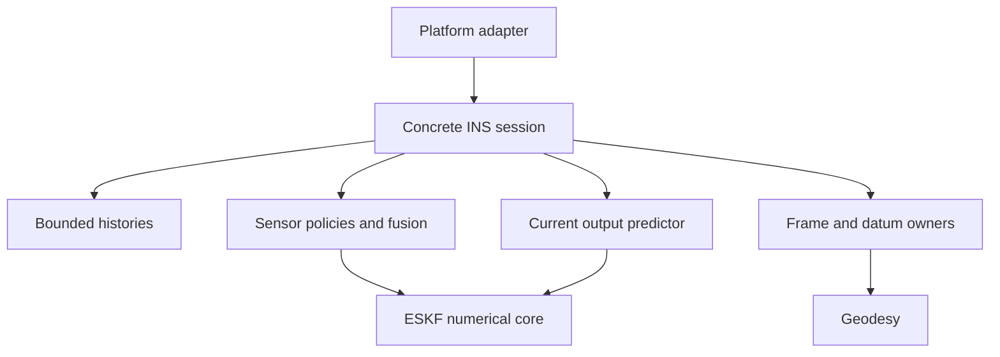

# Portable Navigation Runtime Architecture

## Scope and requirements

[SW-NAV](../requirements/software/navigation-runtime.md) defines a concrete,
caller-driven INS session. [C-LAYER-BOUNDARY](../requirements/common/layer-boundaries.md)
and the [C++ subset](../requirements/common/cpp-subset.md) constrain dependencies
and implementation. Implementation status belongs
to [A-01](../../roadmap.md#a-01--portable-navigation-runtime).

The first profile preserves existing binary64 geographic INS behavior, including
the PX4 250 Hz timing and strict startup. Core equations, numerical choices and
AHRS APIs remain unchanged. New rate modes, staged startup, stationary updates,
strict continuous odometry and legacy replay migration require separate work.

The [staged INS target](../profiles/staged-ins.md) allocates that startup and
degradation work to [R-INS-STARTUP](../requirements/runtime/ins-startup.md) and
[R-INS-CAPABILITIES](../requirements/runtime/ins-capabilities.md). The target keeps
one full INS and existing phase ownership. It separates output admission from
state dimension, geographic admission and source lifecycle. An attitude-only
output path uses current quaternion/history without requiring position geometry;
frame attachment coordinates the affected owners when geographic prerequisites
become available. This is a Draft target, not implemented extraction behavior.

## Responsibilities and interfaces

| Owner | State and responsibility | External boundary |
|---|---|---|
| INS session | Main state/P, bootstrap, component coordination, fault/reset state | Receives explicit inputs/time/configuration; returns phase results and coherent views |
| Histories | IMU intervals, observations, context, generations and watermarks | Fixed storage; no device or clock acquisition |
| Sensor owners | Qualification, sampling, source lifecycle and recovery | Consume explicit context and current prior; no platform flags or message publication |
| Frame/datum owners | Working/reference geometry, datum and prepared origin event | Geodesy supplies pure transformations |
| Output predictor | Current nominal state, retained history and delayed feedback | Separate epoch; no current covariance or sensor-selection authority |
| Adapter | Drivers/messages, time conversion, external context/model lookup, scheduling and publication | One writer invokes bounded session phases |

Runtime headers are grouped by responsibility: `history/`, `frames/`, `fusion/`,
`sensors/` and `session/`. Sensor families may have cohesive subdirectories.
Directory grouping does not create inheritance, policy dispatch or one-class-per-
file obligations. Histories depend on sample values/storage, not prediction
policy. Session composes lower components; lower components do not include it.

## Execution and state

The adapter supplies admitted source records with sample and arrival times in a
common monotonic domain. It supplies historical motion/vehicle context and
external magnetic-reference results with explicit provenance. The caller validates the complete profile before startup; component checks
retain their own domains and do not validate the entire session configuration. Fixed backing storage is not resized while running.

The profile defines bounded phase ordering. For PX4, retain
[PX4-EXEC](../requirements/integration/px4/execution.md): current IMU output and
attitude publication precede delayed prediction/fusion; feedback, completion and
any coordinated rebase precede navigation publication. The portable interface
must preserve this split rather than acquire a platform publication callback.
No-IMU expiry/status processing does not advance either estimator horizon.

The session delegates numerical transactions to existing operations and preserves
their failure precedence. A callback is not one atomic transaction. Origin changes
use prepare/commit across all participants; ordinary source updates retain their
existing individual commit boundaries. Diagnostics are copied after a bounded
phase; concurrent readers synchronize in their adapter, not inside the runtime.

The [ordered session contract](../requirements/runtime/ins-session.md) owns the
startup/model/seed and current/fusion/model/completion phase protocol. The public
[session header](../../../include/formal_eskf/runtime/session/ins_session.hpp)
includes grouped template definition headers; callers include the public header.
Take raw innovation events after each completed phase; the PX4 adapter applies its
reporting filters to those events and then publishes synchronized snapshots.

## Design decisions

Use one concrete INS owner and direct calls. Keep standalone components/core
usable; do not create a dynamic sensor registry or a configurable stage graph.
Parameter records represent actual component settings with units and validation,
not a generic key/value container. Default profile values belong to deployment
bindings; pure numerical constants retain their existing owners.

Extract histories, output tracking and sensor coordination before switching the
complete module owner. Move reusable tests with their owners and retain adapter
provenance/publication tests. Do not retain duplicate module/session state or
permanent include shims after the switch. PX4-specific reporting, parameter
loading and WMM lookup remain in the adapter.

## Verification boundary

Preserve source/proof identities through path changes and review any change to
producer premises, ownership or configuration. Native equivalence traces compare
the same compiler/backend/profile; cross-backend comparisons use justified
numerical tolerances. Independent expected-value/scenario tests remain necessary.

Standalone builds establish dependency separation, not target real-time behavior.
Inspect storage, stack, allocation and maximum phase work under named profiles.
No host result establishes embedded WCET, full module formal refinement or flight
qualification. Keep those obligations in the existing verification/resource work.
