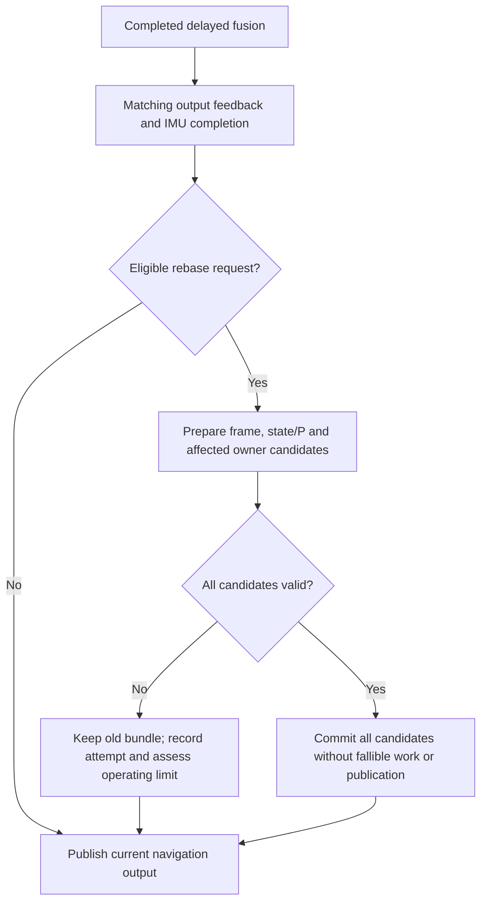

# Origin Rebasing Architecture

## Scope and requirements

Allocate [R-ORIGIN-REBASE](../requirements/runtime/origin-rebasing.md),
[R-HEIGHT-DATUM](../requirements/runtime/height-datum.md),
[R-FRAME-OBSERVATIONS](../requirements/runtime/frame-observations.md) and
[R-PX4-ORIGIN-REBASE](../requirements/integration/px4/origin-rebasing.md).
These Draft contracts own behavior; this architecture owns the dependency and
storage allocation. The [roadmap](../../roadmap.md#f-054-implementation-order)
tracks implementation and acceptance separately.

Preserve the Cartesian state and motion equations, body-local right attitude
error, fixed-size linalg and existing scalar/backend choices. No geodetic state,
generic estimator framework or new platform dependency enters the numerical core.

## Responsibilities and interfaces

| Layer | Owns | Consumes / produces |
|---|---|---|
| Geodesy | WGS84 geometry and immutable-at-use local-frame values. | Geographic/ECEF/NED positions, basis and rigid transforms in binary64. No clocks, sensor acceptance or estimator ownership. |
| Numerical core | Prediction, observation equations, generic correction, injection/reset. | Caller-owned Cartesian state/P, model parameters and observation residual/H/V. No geographic origin, GNSS datum or frame-trigger policy. |
| Portable runtime | Checked state/P rebasing, datum filter, observation preparation and frame-dependent sensor-policy history. | Explicit frames, samples and caller times. Reports candidate results/status; never schedules the whole estimator or publishes uORB. |
| PX4 module/helpers | Working frame, fixed publication reference, admitted sensor provenance, delayed/current histories and transaction/publication ordering. | Bind reusable operations to real epochs, capacities, deployment settings and PX4 outputs. |
| Replay | Stable dataset basis, explicit/automatic event driving and comparison output. | Reuse geometry/runtime operations; no second Python implementation of frame mathematics. |

[NavigationFrame](../../../include/formal_eskf/runtime/frames/navigation_frame.hpp) owns
the working/fixed geometric frames, cached transform and persistent state/P
candidate. It does not own sensor history, datum, scheduling or publication;
the adapter coordinates those owners before committing.

The working frame and the fixed input/publication references are different owned
values. An origin-generation counter, if needed for diagnostics, shall not be
used as a sensor/calibration generation. Templates remain numeric/backend/capacity
bindings, not a generic callback or policy-dispatch mechanism.

## State and reference inventory

The source links locate the owners of each frame-dependent value. The event
treatment defines their responsibilities; verification evidence remains scoped
to the requirement and profile, rather than inferred from this inventory.

| Owner / data | Basis and epoch | Treatment at an internal rebase |
|---|---|---|
| [FormalEskf](../../../integrations/px4/module/FormalEskf.hpp): state/P | Working NED p/v/q; body-local attitude errors and biases; delayed main epoch. | Prepare state/P via R-ORIGIN-REBASE; commit with the working frame. |
| Working frame / datum | Binary64 ECEF origin/basis; datum's actual GNSS sample epoch. | Select post-fusion estimated IMU position; keep held geoid separation/epoch unchanged. |
| `NavigationOrigin` | Fixed PX4 projection reference, MSL altitude and reference epoch. | Preserve; do not reuse as the mutable working frame. |
| [OutputPredictor](../../../include/formal_eskf/runtime/session/output_predictor.hpp): current and ring samples | Working NED, one epoch per sample. | Transform every retained p/v/q and current sample without changing indices, capacity, times or fusion watermark. |
| Output tracking errors/sums | Navigation p/v, body attitude correction and IMU bias/rate feedback. | Rotate p/v errors and sums; preserve body values and tracking/fault state. |
| [ImuHistory](../../../include/formal_eskf/runtime/history/imu_history.hpp) | Body rates/increments, integration intervals, admission/complete watermarks. | Preserve complete storage/metadata. Complete the actual delayed interval once before the event. |
| [ObservationHistory](../../../include/formal_eskf/runtime/history/observation_history.hpp) and selected samples | Raw geodetic GNSS, receiver-local velocity, body field, pressure altitude and historical flight context. | Preserve queues, selected source epochs and generations. Prepare active-frame observation models only at consumption. |
| [GNSS coordination](../../../integrations/px4/module/FormalEskfNavigation.cpp) | Quality uses adjacent fixes/receiver NED; fusion diagnostics use declared observation axes. | Preserve source/lifecycle/quality/ratios and cached diagnostics whose basis is unchanged. Recompute newly consumed h/H; bind real recovery resets to the observation axes. |
| [HeightAiding](../../../include/formal_eskf/runtime/sensors/height/height_aiding.hpp) | Scalar MSL reference, barometer bias, source history and Down-positive observation diagnostics. | Preserve physical datum/bias and timers. Supply the geographic height prediction/Jacobian instead of assuming internal p_z is MSL-relative altitude. |
| [MagneticModel](../../../include/formal_eskf/runtime/sensors/magnetic/magnetic_model.hpp) | Model/observation vectors in their fixed reference basis; model revision/source identity. | Keep references in that basis and transform vectors on use. Do not trigger a WMM adoption, reference revision or heading reset merely for rebasing. |
| [MagneticHeading](../../../include/formal_eskf/runtime/sensors/magnetic/magnetometer.hpp) | Filtered navigation force vector, scalar heading-error history and consistency latch. | Rotate complete force history; invalidate/reseed scalar history from a real new-frame sample; preserve the latch until normal evidence updates it. |
| Magnetic body filter / lifecycle | Body field and source qualification, rejection/recovery times. | Preserve; recompute directional field checks for new observations in the current frame. |
| [TiltAlignment](../../../include/formal_eskf/runtime/session/tilt_alignment.hpp) | Delayed q/P-derived tilt variance and established-alignment latch. | Recompute variance in the new basis while preserving the existing latch at the event. |
| Vertical health / bias learning / gravity sampling | Observation-basis residuals, body clipping/rate/force history and time holds. | Preserve. Use coherent new Down-aligned gravity for subsequent prediction/aiding; no source reset, new successful sample or artificial healthy interval. |
| Reset reports / validity / output covariances | PX4 publication convention; current state and separately declared delayed proxies. | Preserve reset records on coordinate-only events. Transform proxies at their own epoch; do not reinterpret delayed P as current covariance. |
| [Replay](../../../examples/replay_ins.cpp) prepared navigation/magnetic inputs | Fixed seed NED and their original sample times. | Keep input/reference values; model observations in their basis and map state/P back for output. |

### Observation and recovery paths

GNSS position, receiver velocity and scalar height do not necessarily use the
working-frame axes. Prepare residual/H/V explicitly using R-FRAME-OBSERVATIONS;
preserve the existing group order, gates and sensor eligibility. The generic
correction path owns arbitrary H; axis-specialized generated kernels are selected
only when their premises actually hold.

Recovery resets also need their observation basis. A horizontal-only reset shall
not overwrite an unrelated working-frame Down component, and a height reset shall
act along the declared local vertical. Use explicit coordinate preparation around
the existing checked reset operation, including full P transport, or an equivalent
reviewed projector. Do not change normal fusion mathematics to make a convenience
API accept the wrong frame. Actual reset deltas are computed from consumer-visible
before/after output, separately from the internal frame event.

## Execution and transaction boundary

The [existing callback](../../../integrations/px4/module/FormalEskf.cpp) completes
prediction/fusion, output feedback and the delayed IMU acknowledgement before
navigation publication. Insert at most one requested frame event at that boundary:

The event owner borrows state/history; it does not copy the full module. Keep
large state/P scratch and predictor staging in fixed persistent storage. Reuse
the predictor's existing persistent staged ring where practical. Small policy
candidates may be copied, with their cost included in the call-chain assessment.
Preparation must not set an owner's permanent fault latch merely because the
optional event candidate failed. No owner may mutate visible state until all
preparations succeed. Commit performs bounded assignments, with no sensor calls,
allocation, I/O or second numerical calculation that could fail.

Keep ordinary prediction/correction failure semantics distinct: rollback of an
optional rebase does not roll back the already completed fusion cycle. The
reference/output contract makes earlier attitude publication remain meaningful;
uORB messages are not claimed to be an atomic multi-topic transaction.

Replay and module tests can explicitly request this path. Automatic module
selection uses the same transaction with the assessed envelope and configured
dwell/retry limits. It does not create a second implementation.

## Verification boundary

Each owner has success, no-op and failure-preservation tests before composition.
Integration checks exercise the actual callback, unequal epochs, nonzero sensor
offsets, full/wrapped rings, stale inputs and active faults. Frozen-event ECEF
p/v/attitude and publication invariance differ from later dynamics under the
refreshed gravity model. Independent error/resource assessment precedes automatic
enablement. Existing formal evidence is retained with its original scope; source
changes and new transitions need a later evidence refresh.

## File and interface discipline

Reuse the current geodesy/state-P operations and generic correction. A small
portable datum/history component and frame-observation helpers are justified by
independent contracts; no geographic wrappers are added to each core operation.
Existing predictor/history helpers remain in the integration directory because
their contracts include its timing profile. The final refactor reviews actual
coupling and duplication, not a prescribed file count. No C++ declaration is
duplicated here; canonical headers own concrete signatures when implemented.

## Geometry and publication ownership

The adapter builds local geographic snapshots from each unchanged estimate.
Each snapshot contains its checked geographic point, ECEF point and working-to-
geographic rotation. Admission reuses that ECEF point for the datum-distance
check; the transaction consumes the same main/current snapshots before any
owner commits. These are call-local values, not caches that can survive a frame,
state or epoch change. Only the single writer constructs and consumes them.

One delayed body-point basis supplies the position, velocity and attitude
variance proxies for each navigation publication. Local position and odometry
share those results; current output attitude never replaces the delayed basis.
Standalone heading/status queries still obtain their own matching delayed basis.
The fast attitude phase checks numerical output freshness directly and does not
run unused navigation admission or aiding diagnostics.

The existing `FormalEskfFrames.cpp` groups datum, geometry, admission and the
origin transaction. `FormalEskfOutput.cpp` owns message mapping and reset
notifications; predictor and height owners retain their transactional scratch.
No persistent derived-geometry cache, second covariance, generic policy dispatch
or additional frame backend is required. Portable rotation extraction remains
one shared operation used by rebasing and geographic publication.
